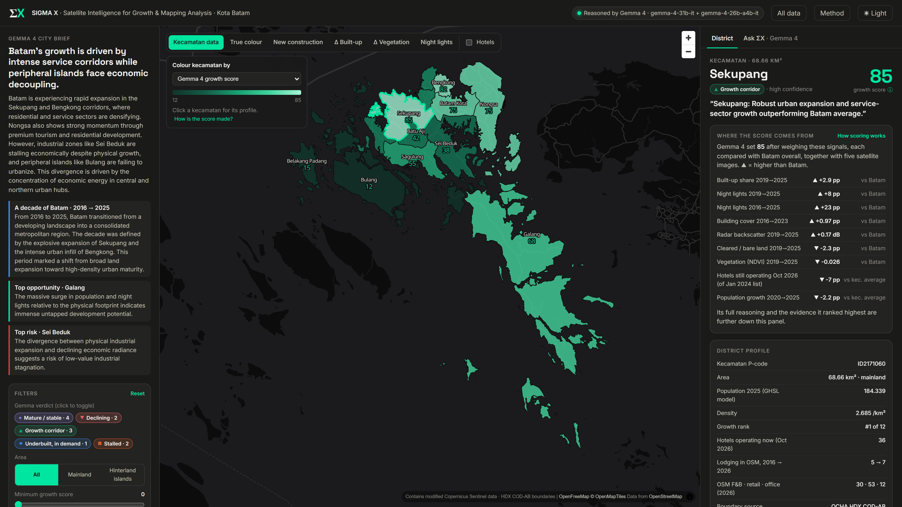
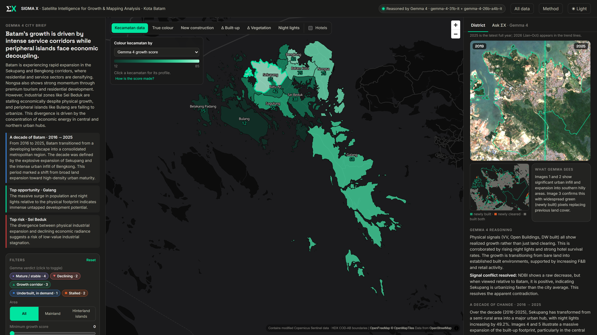
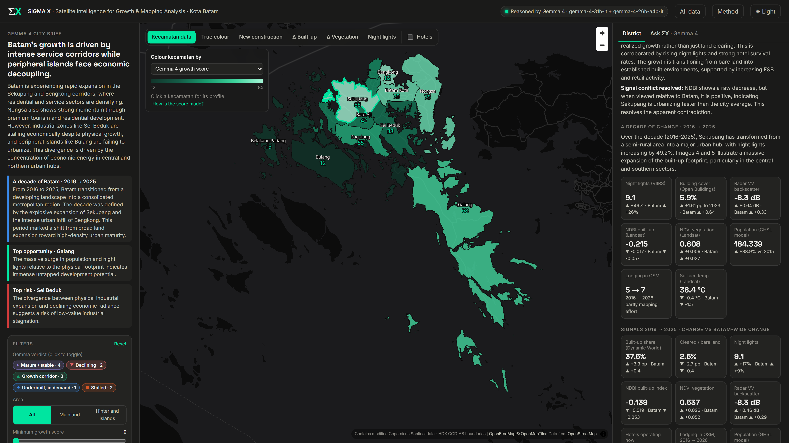
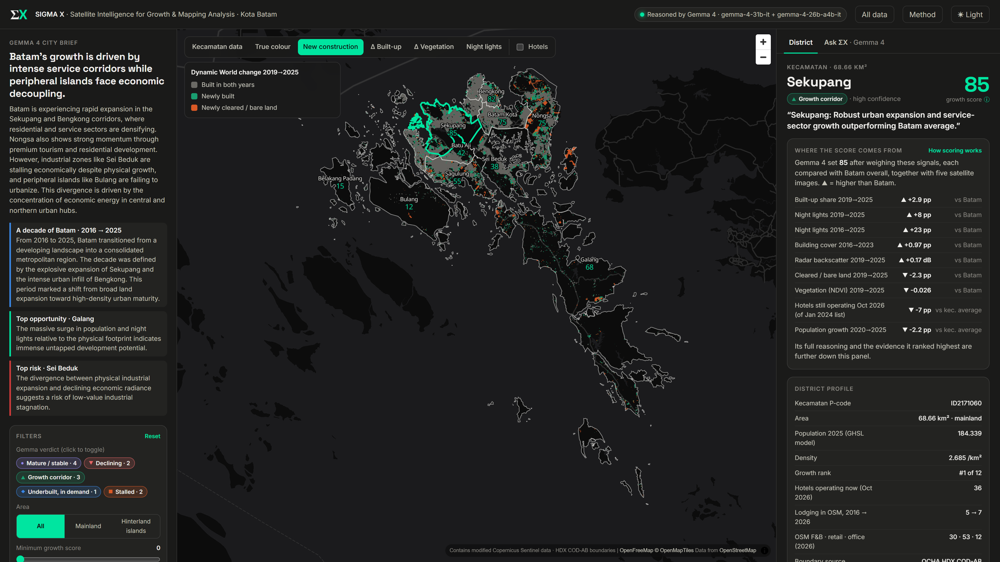
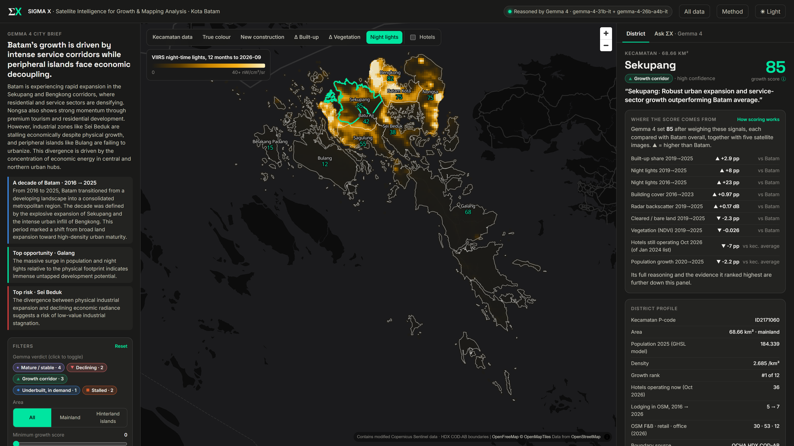
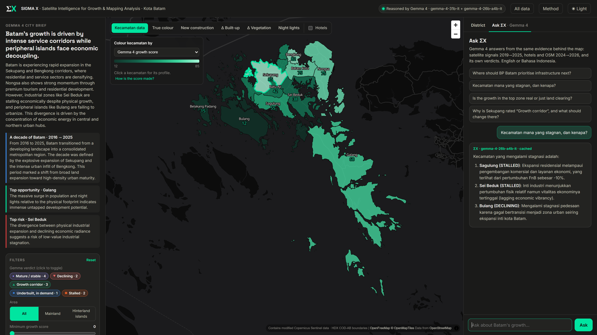
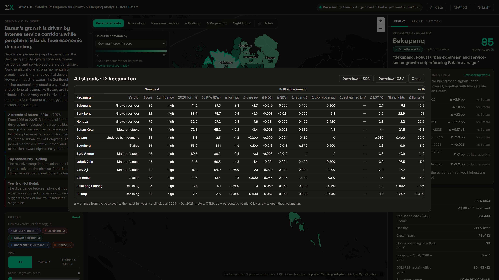
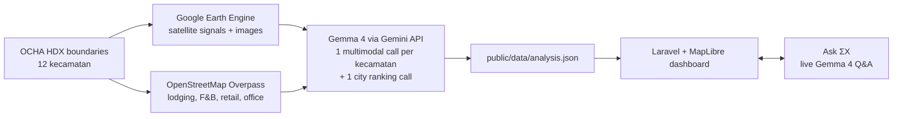

# ΣX — SIGMA X
**Satellite Intelligence for Growth & Mapping Analysis · Kota Batam**

> Where is Batam *actually* growing? SIGMA X reads ten years of satellite imagery and
> on-the-ground activity data for Batam's 12 kecamatan (districts). **Gemma 4** acts as the analyst:
> it explains which areas are genuinely growing, which are only clearing land, and which are stalling.

**[▶ Live demo](https://sigmax-809511909180.asia-southeast1.run.app/)** · Built at **Hacktoberfest Hack Day Kota Batam × Batam Innovation Center** (31 Oct 2026) · Track: **Best Use of Gemma 4**



## The problem
Batam is growing fast through its free-trade and special economic zones, but checking real progress
still means site visits and scattered datasets. A simple rule like "the built-up index went up, so
the area is growing" can't tell a finished estate from a cleared lot, or a new housing estate from a
neighbourhood where people actually work and shop.

## What SIGMA X does
For each of the 12 kecamatan, SIGMA X:

1. **Measures physical change from space**, 2019 → 2025 plus a 2016 → 2025 decade view: built-up and
   vegetation indices, land cover, radar, building footprints, land temperature and coastal reclamation.
2. **Measures activity on the ground**: night lights, and OpenStreetMap counts of hotels and other
   lodging, F&B, retail and offices for Jan 2016, Jan 2024 and today.
3. **Asks Gemma 4 to judge it.** Gemma reads the numbers *and* five satellite images, settles the
   signals that disagree, and returns a verdict, a 0–100 growth score, its reasoning, a 2028 outlook
   and a recommendation for BP Batam / Pemko Batam.
4. **Shows it all on a map**, with **Ask ΣX**: ask Gemma 4 anything about Batam's growth in English or
   Bahasa Indonesia, and it answers only from this evidence.

## Gemma 4 is the analyst, not a caption writer
Each kecamatan gets one multimodal Gemma 4 call:

- **In:** the recent and decade signals as JSON, each also compared with the Batam-wide change, plus
  five images: true colour 2019 and 2025, a change map (newly built / newly cleared / built in both),
  and Landsat 2016 and 2025.
- **Out:** a verdict, a growth score, what it sees in the images, its reasoning, how it resolved
  conflicting signals, the evidence it relied on, a decade story, a 2028 outlook and a recommendation.

A final call ranks all 12 kecamatan and writes the city brief, the top opportunity and the top risk.

Signals often disagree, which is where a threshold rule fails and Gemma earns its place. Some real
examples from this run:

| Kecamatan | What disagreed | How Gemma 4 resolved it |
|---|---|---|
| Sei Beduk | Built-up share rose faster than Batam's, but night lights fell behind | *"the new construction is likely low-activity residential or low-value industrial infill rather than high-intensity economic growth"* → **Stalled** |
| Galang | Built-up indices fell while night lights and population rose | *"a lag between human arrival and formal urbanization"* → **Underbuilt, in demand** |
| Belakang Padang | Population rose while night lights and the built-up index fell | *"growth is likely informal or low-intensity residential, lacking industrial or commercial density"* → **Declining** |

Every verdict is one of six classes:

| Verdict | Meaning |
|---|---|
| Growth corridor | Built-up area and activity both rising: realized growth |
| Early stage | Land is being cleared or prepared; structures not finished yet |
| Underbuilt, in demand | Activity rising faster than construction: demand ahead of supply |
| Stalled | Construction rose but activity did not follow |
| Mature / stable | Already dense, little physical change, activity steady |
| Declining | Activity and/or built-up signals falling |

Models: `gemma-4-31b-it`, falling back to `gemma-4-26b-a4b-it` when 31B is overloaded. Each verdict
records which model wrote it (this run: 4 from 31B, 8 from 26B).

## Results
Gemma 4 run of 31 Oct 2026.
> *"Batam's growth is driven by intense service corridors while peripheral islands face economic decoupling."*

| Rank | Kecamatan | Verdict | Score | Gemma 4's headline |
|---:|---|---|---:|---|
| 1 | Sekupang | Growth corridor | 85 | Robust urban expansion and service-sector growth outperforming Batam average |
| 2 | Bengkong | Growth corridor | 82 | Intense urban infill and residential densification driving significant economic activity |
| 3 | Nongsa | Growth corridor | 75 | Premium tourism and residential expansion driving steady economic and physical growth |
| 4 | Batam Kota | Mature / stable | 75 | Established urban core driving Batam's service economy through intense densification |
| 5 | Galang | Underbuilt, in demand | 68 | Population and light surge outpaces physical built-up footprint |
| 6 | Sagulung | Stalled | 55 | Residential expansion outpacing commercial and economic service development |
| 7 | Batu Ampar | Mature / stable | 45 | Mature port hub with steady infill and high economic resilience |
| 8 | Lubuk Baja | Mature / stable | 45 | Dense urban core consolidating through retail and service-sector intensification |
| 9 | Batu Aji | Mature / stable | 42 | Mature residential-industrial hub shifting from land expansion to internal densification |
| 10 | Sei Beduk | Stalled | 38 | Industrial core showing relative physical growth but lagging economic vibrancy |
| 11 | Belakang Padang | Declining | 15 | Economic activity and built-up footprint decoupling from population growth |
| 12 | Bulang | Declining | 12 | Rural stagnation: Bulang falls behind as Batam's urban core expands |

- **Top opportunity: Galang.** Population and night lights are surging ahead of its physical footprint.
- **Top risk: Sei Beduk.** Industrial building is expanding while economic activity declines.

## The dashboard
- **Map** (MapLibre + OpenFreeMap, light and dark): colour the kecamatan by any measure, or switch to
  true colour, new construction, Δ built-up, Δ vegetation or night-light layers.
- **Filters** by verdict, mainland or hinterland islands, and minimum growth score.
- **District profile:** where the score comes from, a 2019/2025 and a 2016/2025 before/after slider,
  what Gemma sees in the images, its reasoning, evidence, 2028 outlook and recommendation.
- **All data:** every signal for every kecamatan in one table, with CSV export.
- **Ask ΣX:** live Gemma 4 Q&A grounded in the same evidence (English or Bahasa Indonesia).

<table>
<tr>
<td width="50%"><br><sub>Before/after slider and what Gemma 4 sees in the images</sub></td>
<td width="50%"><br><sub>Gemma 4's reasoning, resolved conflict and decade story</sub></td>
</tr>
<tr>
<td><br><sub>New construction layer</sub></td>
<td><br><sub>Night lights layer</sub></td>
</tr>
<tr>
<td><br><sub>Ask ΣX answering in Bahasa Indonesia</sub></td>
<td><br><sub>All data, with CSV export</sub></td>
</tr>
</table>

## How it works



All heavy work runs once in the Python pipeline. The web app only reads precomputed JSON and images,
and calls Gemma 4 live only for Ask ΣX.

| Step | What | Source |
|---|---|---|
| `pipeline/01_zones.py` | 12 kecamatan polygons | OCHA HDX COD-AB (official administrative boundaries) |
| `pipeline/02_satellite.py` | Per kecamatan per year 2019–2026: NDVI, NDBI, MNDWI, Dynamic World built/bare/trees, Sentinel-1 VV radar, VIIRS night lights, Landsat land-surface temperature, Open Buildings 2.5D Temporal, GHSL population, coastal reclamation; before/after and change images; city-wide map overlays | Google Earth Engine |
| `pipeline/02d_decade.py` | The decade view 2016 → 2025, from sensors that existed in both years: Landsat 8/9 NDVI, NDBI and land-surface temperature, VIIRS night lights, Sentinel-1 radar, Open Buildings 2016 → 2023, GHSL population 2015 → 2025 | Google Earth Engine |
| `pipeline/02e_decade_images.py` | Sharp 10 m before/after images, 2016 vs 2025, for the decade slider | Google Earth Engine (Sentinel-2 L1C) |
| `pipeline/03_poi.py` | Hotels and other lodging (hotel, motel, guest house, hostel), F&B, retail and office counts per kecamatan for Jan 2016, Jan 2024 and today | OpenStreetMap Overpass (history) |
| `pipeline/04_gemma.py` | One multimodal Gemma 4 call per kecamatan, then one ranking call for the city brief and decade story | Gemini API: `gemma-4-31b-it`, falling back to `gemma-4-26b-a4b-it` |
| Laravel app | The dashboard and Ask ΣX | `resources/views/dashboard.blade.php`, `app/Http/Controllers/AskController.php` |

## Run it locally

```bash
# 1. data pipeline (Python 3.12)
cd pipeline
python -m venv .venv
.venv/Scripts/activate              # macOS/Linux: source .venv/bin/activate
pip install -r requirements.txt
earthengine authenticate            # once
python 01_zones.py && python 02_satellite.py && python 02d_decade.py && python 02e_decade_images.py
python 03_poi.py && python 04_gemma.py

# 2. web app (PHP 8.1+)
cd ..
composer install
cp .env.example .env && php artisan key:generate
php artisan serve                   # http://localhost:8000
```

`.env` needs:

| Variable | What for |
|---|---|
| `GCP_PROJECT` | A Google Cloud project registered for Earth Engine |
| `GEMINI_API_KEY` | Gemini API key, used for Gemma 4 |
| `GEMMA_MODEL` | `gemma-4-31b-it` |

The precomputed results are already in `public/data/`, so you can skip step 1 and run only the web
app. Ask ΣX still needs `GEMINI_API_KEY`.

## Deploy
```bash
gcloud run deploy sigmax --source . --region asia-southeast1 --project sigmax-batam-2026 --allow-unauthenticated
```
See `Dockerfile`. The live demo is public: never deploy with `--no-allow-unauthenticated`, because it
removes public access. `GEMINI_API_KEY` comes from the separate, unbilled project `sigmax-gemma-2026`
so Gemma calls stay on the free tier.

## Repository layout
```
pipeline/                                Python data pipeline (Earth Engine, OpenStreetMap, Gemma 4)
public/data/                             precomputed output the app serves: analysis.json, zones.geojson, images
resources/views/dashboard.blade.php      the dashboard (MapLibre, plain JavaScript)
app/Http/Controllers/AskController.php   Ask ΣX: live Gemma 4 Q&A
routes/api.php                           POST /api/ask (rate-limited)
media/screenshots/                       screenshots used in this README
Dockerfile                               Cloud Run image
```

## Limits
- These are indicators, not official statistics.
- OSM counts, hotels included, partly reflect how much volunteers mapped, especially in 2016 when few
  Batam businesses were on the map.
- The decade view starts in 2016: that is the first year with consistent Landsat 8, night-light,
  radar and building data over Batam. 2011 has only a few striped Landsat 5/7 scenes and no
  night-light, radar or building data.
- Sentinel-2 over Batam is cloud-limited, so annual cloud-masked medians are used.
- 2019 was a dry year, so every kecamatan is also compared with the Batam-wide change.
- Population is GHSL modelled data.
- Gemma's verdicts are judgments, not measurements. Each one shows its evidence and reasoning so a
  person can check it.

## AI tools used
- **Gemma 4** (`gemma-4-31b-it` and `gemma-4-26b-a4b-it`, via the Gemini API): the per-kecamatan
  analysis, the city ranking and the live Q&A in the product.
- **Claude Code** (Anthropic): coding assistant during the hackathon.

## Data credits
Contains modified Copernicus Sentinel data 2016–2026. Dynamic World (Google / WRI), VIIRS DNB
(NOAA EOG), Landsat (USGS), Open Buildings 2.5D Temporal (Google Research), GHSL (EC JRC),
boundaries OCHA HDX COD-AB, © OpenStreetMap contributors, basemap OpenFreeMap / © OpenMapTiles.
